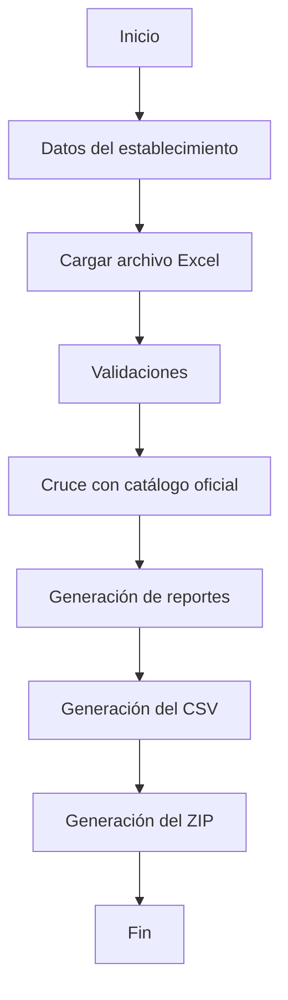

# Flujo de negocio

> **Propósito:** Describir el comportamiento funcional de la aplicación desde la entrada de datos hasta la generación de los archivos finales.

> [!NOTE]
> Este documento describe **qué hace** la aplicación. Los detalles de implementación y la organización del código pueden consultarse en la documentación de arquitectura.

## Objetivo

La aplicación transforma una lista de precios de una oficina farmacéutica en un archivo compatible con la carga masiva del Observatorio de Precios de DIGEMID.

El sistema automatiza las tareas de validación, cruce de información, clasificación de registros y generación de archivos finales.

Su propósito es reducir un proceso manual de varias horas a un flujo guiado que pueda completarse en pocos segundos.

---

## Alcance

Esta versión está orientada a:

- Farmacias y boticas del sector privado.
- Un establecimiento por archivo.
- Procesamiento de listas de precios en formato Excel.
- Validación mediante el catálogo oficial del Observatorio de Precios.
- Generación de archivos CSV y ZIP.
- Generación de reportes de control.

La aplicación no reemplaza la revisión profesional de la información. Su responsabilidad consiste en organizar, validar y transformar los datos proporcionados por el usuario.

---

## Entradas del sistema

La aplicación trabaja con tres grupos de información.

### Datos del establecimiento

El usuario debe proporcionar:

- RUC.
- Código de establecimiento.
- Mes.
- Año.
- Tipo de proceso.

Estos datos se utilizan para validar la operación y construir el nombre final de los archivos generados.

### Catálogo oficial

El catálogo oficial del Observatorio de Precios constituye la fuente oficial de validación.

La aplicación permite:

- Descargar el catálogo oficial.
- Conservar temporalmente el archivo original.
- Limpiar la información innecesaria.
- Generar una versión optimizada para el procesamiento.

El catálogo limpio permite validar el registro sanitario y obtener el código oficial correspondiente a cada producto.

### Archivo de precios

El usuario debe proporcionar un archivo Excel con su lista de precios.

Las columnas obligatorias son:

| Columna | Descripción |
|---------|-------------|
| `registro_sanitario` | Registro sanitario del producto. |
| `precio_empaque` | Precio de venta por empaque. |
| `precio_unidad` | Precio de venta por unidad. |
| `unidades_por_empaque` | Cantidad de unidades contenidas en cada empaque. |

El archivo puede contener columnas adicionales. Estas serán ignoradas durante el procesamiento, salvo aquellas que se conserven expresamente para facilitar la generación de reportes.

---

## Flujo general

El procesamiento sigue una secuencia de pasos diseñada para minimizar la intervención manual del usuario y garantizar la consistencia de la información generada.

> [!TIP]
> El catálogo oficial puede actualizarse en cualquier momento desde la aplicación. Esta operación es independiente del procesamiento del archivo de precios y garantiza que las validaciones se realicen utilizando la información más reciente disponible.

---

## Procesamiento

Una vez recibida toda la información necesaria, la aplicación ejecuta una serie de etapas cuyo objetivo es validar, enriquecer y transformar los datos proporcionados por el usuario.

### 1. Validación del establecimiento

Antes de iniciar el procesamiento, se verifica que la información del establecimiento sea válida y esté completa.

Se comprueba:

- RUC.
- Código del establecimiento.
- Mes.
- Año.
- Tipo de proceso.

Si alguno de estos datos es inválido o se encuentra incompleto, el procesamiento se detiene hasta que el usuario corrija la información.

---

### 2. Preparación del catálogo

El catálogo oficial constituye la fuente de referencia para todas las validaciones.

Cuando el usuario decide actualizarlo, la aplicación:

1. Descarga la versión más reciente.
2. Conserva temporalmente el archivo original.
3. Limpia la información innecesaria.
4. Genera un catálogo optimizado para el procesamiento.

Durante la generación de reportes únicamente se utiliza esta versión procesada del catálogo.

---

### 3. Lectura del archivo Excel

La aplicación carga el archivo proporcionado por el usuario y verifica la existencia de las columnas obligatorias.

Posteriormente se leen únicamente los datos necesarios para el procesamiento, ignorando cualquier columna adicional que no intervenga en las validaciones.

---

### 4. Validación de la información

Cada registro es analizado individualmente.

Entre las validaciones realizadas se encuentran:

- Existencia del registro sanitario.
- Formato de los datos.
- Valores numéricos válidos.
- Coherencia entre los precios registrados.
- Disponibilidad del producto en el catálogo oficial.

Los registros que no superan alguna validación son clasificados para su posterior revisión.

---

### 5. Cruce con el catálogo oficial

Los registros sanitarios válidos son comparados con el catálogo oficial.

Este proceso permite:

- Obtener el código oficial del producto.
- Confirmar la existencia del registro sanitario.
- Recuperar la información necesaria para construir el archivo final.

---

### 6. Generación de resultados

Una vez completadas las validaciones y el cruce de información, la aplicación genera automáticamente todos los archivos de salida.

Cada registro queda clasificado según el resultado obtenido durante el procesamiento.

---

## Salidas

Al finalizar el procesamiento, la aplicación genera automáticamente todos los archivos necesarios para que el usuario pueda revisar la información y realizar la carga en el Observatorio de Precios.

Los archivos generados son:

| Archivo | Descripción |
|---------|-------------|
| **CSV** | Archivo compatible con el sistema de carga del Observatorio de Precios. |
| **ZIP** | Archivo comprimido que contiene el CSV y los reportes generados. |
| **Productos válidos** | Relación de los productos que superaron todas las validaciones. |
| **Productos descartados** | Registros que no pudieron procesarse por inconsistencias o ausencia en el catálogo oficial. |
| **Errores de precio** | Productos cuya información de precios requiere revisión antes de su envío. |

Todos los archivos se generan automáticamente y quedan disponibles para su descarga desde la interfaz de la aplicación.

---

## Consideraciones

> [!IMPORTANT]
> La calidad del resultado depende directamente de la calidad de la información proporcionada por el usuario.

La aplicación automatiza el procesamiento y aplica las validaciones definidas para el proyecto, pero no modifica la información original ni reemplaza la revisión profesional de los datos.

Siempre se recomienda revisar los reportes generados antes de realizar la carga oficial en el Observatorio de Precios.

---
